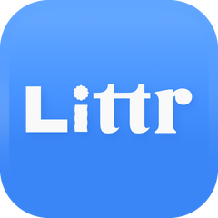
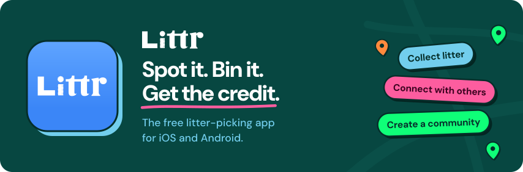

<!-- ───────────── Header ───────────── -->

  

  

  
  
  

<!-- ───────────── About ───────────── -->
<h3>About me</h3>

<table>
  <tr>
    <td width="65%" valign="top">
       
      
I'm a <b>Senior Software &amp; DevOps Engineer</b> at <a href="https://lick.com"><b>Lick</b></a>, one of the UK's fastest-growing names in decorating. I love building things that are fast, secure and look after themselves, and I'm happiest helping a team ship with confidence.

      
Outside work I build <a href="https://littr.info"><b>Littr</b></a>, a free litter-picking app for iOS and Android. The rest of the time you'll find me in my home lab or making a little game.

       
      
🔭 &nbsp;<b>Day to day:</b> full-stack TypeScript, cloud and e-commerce

      
🏠 &nbsp;<b>For fun:</b> home labbing, self-hosting and game dev

      
💬 &nbsp;<b>Ask me about:</b> CI/CD, security, automation and the cloud

       
    </td>
    <td width="35%" align="center" valign="middle">
      BY DAY
        
      <a href="https://lick.com">
        <picture>
          <source media="(prefers-color-scheme: dark)" srcset="assets/lick-logo-white.png" />
          
        </picture>
      </a>
         
      BY NIGHT
        
      
    </td>
  </tr>
</table>

 

<!-- ───────────── Littr ───────────── -->
<h3>What I'm building</h3>

  

<a href="https://littr.info"><b>Littr</b></a> turns litter picking into something you do together. You mark the litter you spot on the map and pick it up if you can, and the pin goes from orange to green for everyone. You can join clean-ups near you, start a team, and earn points, streaks and badges as you go. It's free, with no ads, and run by Litter Pickers Berlin, the non-profit clean-up group where it started.

I build all of it: the native iOS (SwiftUI) and Android (Jetpack Compose) apps, the NestJS API and admin dashboard on DigitalOcean, and the Astro website.

  
  &nbsp;
  

  

 

<!-- ───────────── Toolbox ───────────── -->
<h3>Toolbox</h3>

<table>
  <tr>
    <td align="center"><b>Languages</b></td>
    <td></td>
  </tr>
  <tr>
    <td align="center"><b>Web</b></td>
    <td></td>
  </tr>
  <tr>
    <td align="center"><b>Cloud &amp; DevOps</b></td>
    <td></td>
  </tr>
  <tr>
    <td align="center"><b>Data</b></td>
    <td></td>
  </tr>
  <tr>
    <td align="center"><b>Games &amp; more</b></td>
    <td></td>
  </tr>
</table>

